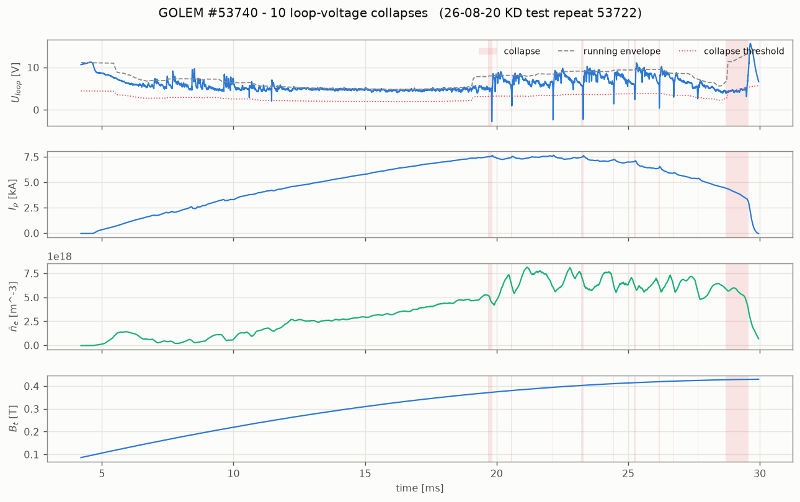
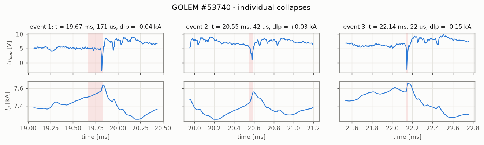
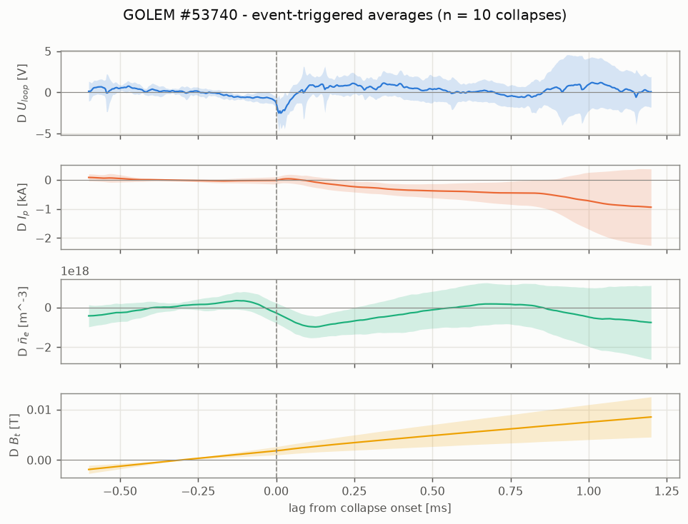

# GOLEM #53740 - repetitive loop-voltage collapse analysis

- date/time: 26-08-20 11:41:01
- session: 53722
- comment: KD test repeat 53722
- diagnostics active: BasicDiagnostics, FastCameras, Interferometry, MiniSpectrometer, PlasmaDetection
- loop-voltage polarity applied: +1

## 1. What was detected

10 loop-voltage collapses, starting at 19.665 ms, repeating every 1.004 ms (CV 0.271), each lasting 0.139 ms and taking -0.484 kA off the plasma current.

## 2. Diagnostics available on this shot

| key        | diagnostic       | unit   |   n_samples |   dt_ms |   fs_kHz |   t_start_ms |   t_end_ms |         min |          max |         mean |
|:-----------|:-----------------|:-------|------------:|--------:|---------:|-------------:|-----------:|------------:|-------------:|-------------:|
| U_loop     | BasicDiagnostics | V      |       40000 | 0.001   | 1000     |   -0.7998    |    39.2    |  -2.791     |   15.7       |    4.699     |
| Ip         | BasicDiagnostics | kA     |       40000 | 0.001   | 1000     |   -0.7998    |    39.2    |  -0.08095   |    7.658     |    3.225     |
| Bt         | BasicDiagnostics | T      |       40000 | 0.001   | 1000     |   -0.7998    |    39.2    |  -4.794e-08 |    0.4305    |    0.3019    |
| Ich        | BasicDiagnostics | kA     |       40000 | 0.001   | 1000     |   -0.7998    |    39.2    |   0         |    1.31      |    0.4847    |
| dIp_dt     | PlasmaDetection  | kA/ms  |       40000 | 1e-06   |    1e+06 |   -0.0007998 |     0.0392 |  -1.038     |    2.04      |   -0.01221   |
| dBt_dt     | PlasmaDetection  | T/ms   |       40000 | 1e-06   |    1e+06 |   -0.0007998 |     0.0392 |  -0.08188   |    0.822     |    0.1551    |
| V_loop_pd  | PlasmaDetection  | V      |       40000 | 1e-06   |    1e+06 |   -0.0007998 |     0.0392 |  -2.791     |   15.7       |    4.715     |
| V_null     | PlasmaDetection  | V      |       40000 | 1e-06   |    1e+06 |   -0.0007998 |     0.0392 |   0.01578   |    0.04391   |    0.03057   |
| L_tot      | PlasmaDetection  | H      |       40000 | 1e-06   |    1e+06 |   -0.0007998 |     0.0392 |   0.009031  |    0.3752    |    0.1573    |
| q_edge_Bt  | PlasmaDetection  | -      |       40000 | 1e-06   |    1e+06 |   -0.0007998 |     0.0392 |   9.38e-07  |    0.4585    |    0.3192    |
| q_edge_Ip  | PlasmaDetection  | -      |       40000 | 1e-06   |    1e+06 |   -0.0007998 |     0.0392 | -93.11      | 8871         | 3580         |
| ne_lav     | Interferometry   | m^-3   |       54402 | 0.00184 |  543.5   |   -5.846     |    93.95   |  -1.158e+17 |    8.144e+18 |    9.875e+17 |
| ne_lav_raw | Interferometry   | m^-3   |       54403 | 0.00184 |  543.5   |   -5.846     |    93.95   |  -1.158e+17 |    5.732e+19 |    3.605e+19 |

## 3. Measured quantities

| quantity | value | unit | meaning |
|---|---:|---|---|
| `n_events` | 10.000 | - | collapses detected |
| `t_onset` | 19.665 | ms | first collapse |
| `period_mean` | 1.004 | ms | mean repetition period |
| `period_cv` | 0.271 | - | period coefficient of variation |
| `duration_mean` | 0.139 | ms | mean collapse duration |
| `depth_mean` | 0.892 | - | mean depth, 1 = down to zero |
| `duty_cycle` | 0.141 | - | fraction of the burst spent collapsed |
| `d_ip_mean` | -0.484 | kA | current step per collapse |
| `d_ip_sum` | -4.845 | kA | current lost in all collapses |
| `staircase_fraction` | 1.106 | - | share of the current decay inside collapses |
| `R_pre_mOhm` | 1.328 | mOhm | plasma resistance before the collapse |
| `R_in_mOhm` | 0.135 | mOhm | plasma resistance during the collapse |
| `R_ratio` | 0.102 | - | resistance ratio in/before |
| `R_test_valid` | 0.000 | - | 1 when the freewheel assumption behind R_in holds |
| `ip_spike_kA` | 0.110 | kA | upward current spike at the event |
| `ip_spike_rel` | 0.015 | - | the same, relative to the pre-event current |
| `delta_li` | -0.072 | - | implied internal-inductance change at conserved flux |
| `spike_fraction` | 0.900 | - | fraction of events showing the upward spike |
| `u_undershoot_V` | -4.479 | V | depth of the loop-voltage spike below its pre-event level |
| `tau_LR_est_ms` | 8.893 | ms | L/R decay time implied by the collapse |
| `flux_before_onset` | 85.860 | mWb | flux delivered before the first collapse |
| `flux_deficit_sum` | 8.443 | mWb | flux not delivered during the collapses |
| `precursor_ratio` | - | - | Mirnov activity growth before the collapse |
| `m_est` | - | - | poloidal mode number of the precursor |
| `f_mode_khz` | - | kHz | precursor frequency |
| `ring_asymmetry_growth` | - | - | growth of the m=1 displacement component |
| `ne_step_rel` | -0.127 | - | density step per collapse |
| `ne_mean` | 3.829e+18 | m^-3 | mean line-averaged density |
| `rail_fraction` | 7.123e-04 | - | in-collapse samples on a flat floor |
| `chamber_swing_kA` | 0.824 | kA | size of the chamber-current correction per collapse |
| `dip_over_chamber_swing` | 0.208 | - | current step divided by that correction swing |
| `tau_chamber_ms` | 0.124 | ms | L/R of the chamber current path |
| `tau_chamber_over_duration` | 0.887 | - | chamber L/R over collapse duration |
| `d_irog_mean` | 0.013 | kA | step of the reconstructed uncorrected total current |
| `ip_dip` | -0.258 | kA | transient current excursion at the collapse |
| `ip_step` | -0.398 | kA | current step still present before the next collapse |
| `ip_recovery` | -0.540 | - | recovered fraction of the current excursion |
| `dip_ratio_irog_ip` | 1.765 | - | excursion in the uncorrected vs published current |
| `ip_dyn_dip` | -0.418 | kA | current excursion with an inductive chamber correction |
| `dip_ratio_dyn_pub` | 1.621 | - | that excursion divided by the published one |
| `R_chamber_implied_mOhm` | 9.557 | mOhm | chamber resistance implied by the shot's own Ich |
| `instability_score` | 0.913 | - | detector ranking score |

## 4. Individual events

|   t_on |   duration_ms |   period_ms |   u_env |   u_min |   depth |   ip_pre |   d_ip |   tau_LR_ms |
|-------:|--------------:|------------:|--------:|--------:|--------:|---------:|-------:|------------:|
| 19.665 |         0.171 |     nan     |   8.000 |  -1.795 |   1.224 |    7.446 | -0.036 |     nan     |
| 20.553 |         0.042 |       0.888 |   8.137 |   1.159 |   0.858 |    7.348 |  0.031 |     nan     |
| 22.138 |         0.022 |       1.585 |   8.429 |  -1.527 |   1.181 |    7.562 | -0.152 |     nan     |
| 23.202 |         0.103 |       1.064 |   9.117 |  -2.192 |   1.240 |    7.414 | -0.129 |     nan     |
| 24.427 |         0.043 |       1.225 |   9.325 |   1.770 |   0.810 |    7.091 | -0.086 |     nan     |
| 25.205 |         0.074 |       0.778 |   9.398 |   2.580 |   0.725 |    6.993 | -0.357 |     nan     |
| 26.167 |         0.033 |       0.962 |   9.527 |   1.104 |   0.884 |    6.374 | -0.233 |     nan     |
| 26.725 |         0.019 |       0.558 |   8.596 |   3.150 |   0.634 |    5.914 | -0.185 |     nan     |
| 27.633 |         0.028 |       0.908 |   7.227 |   2.695 |   0.627 |    5.390 | -0.258 |     nan     |
| 28.704 |         0.859 |       1.071 |  11.969 |   3.153 |   0.737 |    4.543 | -3.440 |       3.345 |

## 5. Hypothesis ranking

| # | mechanism | score | verdict |
|---|---|---:|---|
| H2 | Repetitive minor disruptions / MHD relaxation oscillation | +0.89 | **supported** |
| H4 | Impurity-radiation / recycling limit cycle (MARFE-like thermal relaxation) | +0.50 | **supported** |
| H5 | Volt-second exhaustion / iron-core saturation of the transformer | +0.40 | **supported** |
| H1 | Drive interruption in the primary circuit (thyristor commutation, current-feedback chopping, crowbar) | -0.39 | **weak/mixed** |
| H3 | Runaway-electron dominated phases (resistance collapse and loss bursts) | -0.43 | **contradicted** |
| H7 | Measurement or processing artefact (digitiser clipping, or the U_loop-derived chamber-current correction writing the I_p staircase) | -0.66 | **contradicted** |
| H6 | Vertical/radial position excursion with limiter contact | - | **inconclusive** |

### Evidence

#### H2. Repetitive minor disruptions / MHD relaxation oscillation  (supported, score +0.89)

- current spikes UP by 1.5% at 90% of the events, implying d(l_i) = -0.072 at conserved flux - a sudden internal reconnection flattens the current profile at conserved poloidal flux, which is exactly this signature
- density step = -13 % per event - a crash expels particles
- *not measurable on this shot:* FastSpectrometry, MHDring-TM

#### H4. Impurity-radiation / recycling limit cycle (MARFE-like thermal relaxation)  (supported, score +0.50)

- period = 1.00 ms - radiative/recycling cycles are slow (>~0.5 ms), set by the energy confinement and refuelling times
- *not measurable on this shot:* FastSpectrometry

#### H5. Volt-second exhaustion / iron-core saturation of the transformer  (supported, score +0.40)

- flux delivered before onset = 85.9 mWb - the decisive test is cross-shot: if the onset is set by the core, this number clusters tightly while the onset TIME does not (see the scan-level test)
- onset at t = 19.7 ms - late in the discharge, as expected when the core approaches saturation

#### H1. Drive interruption in the primary circuit (thyristor commutation, current-feedback chopping, crowbar)  (weak/mixed, score -0.39)

- period CV = 0.27 - switching electronics is clock-regular (CV < 0.15)
- rail fraction = 0.00 - a switched-off drive holds U_loop on a flat floor
- Bt_coherent_sigma = 3.2 - other machine circuits switching in step
- Ich_coherent_sigma = 7.0 - other machine circuits switching in step
- current spikes UP by 1.5% at 90% of the events, implying d(l_i) = -0.072 at conserved flux - with the drive merely switched off the current can only decay, so an upward spike rules this out
- *not measurable on this shot:* MHDring-TM

#### H3. Runaway-electron dominated phases (resistance collapse and loss bursts)  (contradicted, score -0.43)

- mean density = 3.83e+18 m^-3 - runaway generation needs a low-density plasma
- current spikes UP by 1.5% at 90% of the events, implying d(l_i) = -0.072 at conserved flux - an inductive spike at conserved flux explains the apparent resistance collapse without any runaway population
- *not measurable on this shot:* ScintillationProbes

#### H7. Measurement or processing artefact (digitiser clipping, or the U_loop-derived chamber-current correction writing the I_p staircase)  (contradicted, score -0.66)

- rail fraction = 0.00, in-event scatter = 1.132 V, floor = -0.399 V - a clipped ADC gives a dead-flat rail
- current step / chamber-correction swing = 0.21 (chamber swing 0.82 kA) - values near 1 mean the I_p staircase could be written by the U_loop-based chamber correction rather than by the plasma
- chamber L/R (0.12 ms) / collapse duration = 0.9 - above 1 the purely resistive chamber correction cannot follow the transient and mis-corrects I_p
- current excursion after redoing the chamber correction with an inductive model, relative to the published one = 1.62 (-0.418 kA vs -0.258 kA) - near 0 the staircase is written by the resistive correction, near 1 it is real plasma current
- recovered fraction of the current excursion = -0.54 - a processing transient recovers completely, a real loss does not

#### H6. Vertical/radial position excursion with limiter contact  (inconclusive, score -)

- no deciding metric available
- *not measurable on this shot:* MHDring-TM (its m = 1 asymmetry tracks the column position)

## 6. Figures

